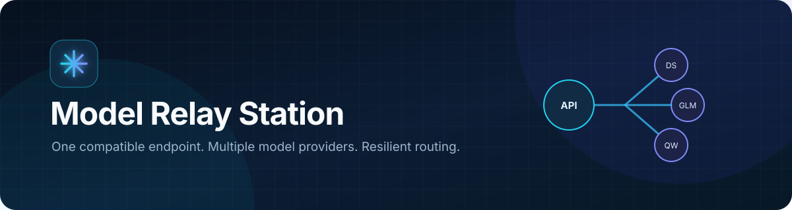
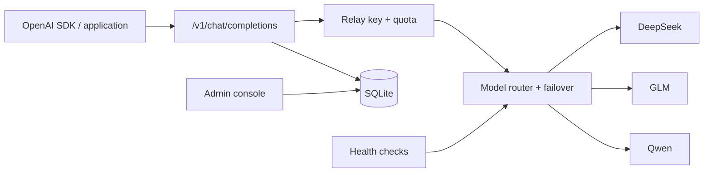

<p align="center">
  
</p>

<p align="center">
  <strong>One OpenAI-compatible endpoint for multiple LLM providers.</strong><br />
  自托管的多模型中转站：统一接入、故障转移、配额控制与可观测管理。
</p>

<p align="center">
  
  
  
  
</p>

> [!IMPORTANT]
> This project is in active early development. Review the security checklist before exposing it to the public internet.

## Why Model Relay Station?

Model Relay Station gives applications a stable API while the upstream provider can change. It centralizes routing, credentials, health checks, quotas, usage logs, and administration without requiring clients to learn a new SDK.

| Capability | What it provides |
| --- | --- |
| OpenAI-compatible API | Drop-in `POST /v1/chat/completions` endpoint with SSE streaming |
| Multi-provider routing | DeepSeek, GLM, and Qwen channel definitions behind one gateway |
| Automatic failover | Retries another healthy channel when an upstream request fails |
| API key quotas | Create relay keys, set limits, disable access, and track usage |
| Health monitoring | Channel availability, latency, last check, and error visibility |
| Admin console | Manage channels and keys; inspect request and usage logs |
| Local-first storage | A lightweight SQLite database with no external control plane |

## Architecture



## Quick start

Requirements: Node.js 20+ and npm.

macOS / Linux:

```bash
npm install
cp .env.example .env.local
npm run dev
```

Windows PowerShell:

```powershell
npm install
Copy-Item .env.example .env.local
npm run dev
```

Before starting, replace both admin values in `.env.local` with strong, unique secrets:

```dotenv
ADMIN_PASSWORD=replace-with-a-strong-password
ADMIN_SESSION_SECRET=replace-with-at-least-32-random-characters
```

Open `http://localhost:3000/admin` and sign in with `ADMIN_PASSWORD`.

## Call the gateway

Create a relay key in the admin console, then point any OpenAI-compatible client at this service:

```bash
curl http://localhost:3000/v1/chat/completions \
  -H "Authorization: Bearer sk-relay-your-key" \
  -H "Content-Type: application/json" \
  -d '{
    "model": "auto",
    "messages": [{"role": "user", "content": "Say hello in one sentence."}],
    "stream": false
  }'
```

Supported public model aliases:

- `auto` — route across available healthy channels.
- `deepseek-v4` — defaults to the configured DeepSeek mapping.
- `glm-5`
- `qwen-plus`

For streaming responses, set `"stream": true`.

## Configuration

| Variable | Required | Purpose |
| --- | --- | --- |
| `ADMIN_PASSWORD` | Yes | Admin console login password |
| `ADMIN_SESSION_SECRET` | Yes | HMAC secret for signed admin sessions |
| `DEEPSEEK_API_KEY` | Per provider | DeepSeek upstream credential |
| `ZHIPU_API_KEY` | Per provider | GLM upstream credential |
| `DASHSCOPE_API_KEY` | Per provider | Qwen upstream credential |
| `DATABASE_PATH` | No | SQLite location; defaults to `data/ai-relay.sqlite` |
| `HEALTH_CHECK_INTERVAL_MS` | No | Provider health-check interval |
| `ENABLE_HEALTH_SCHEDULER` | No | Enables scheduled checks when set to `true` |

The admin console remains usable when an upstream key is missing; its channel is shown as unconfigured or unavailable.

## Quality checks

```bash
npm run typecheck
npm run build
```

The CI workflow runs both checks for every pull request and push to `main`.

## Security

- The application intentionally has no built-in admin password or session-secret fallback.
- Never commit `.env.local`, upstream credentials, relay keys, or the SQLite database.
- Put the service behind HTTPS and a trusted reverse proxy before public deployment.
- Rotate all upstream and relay keys after a suspected leak.
- See [SECURITY.md](SECURITY.md) for supported reporting practices and the deployment checklist.

## Roadmap

- [ ] Docker and Compose deployment
- [ ] Provider adapters and configurable model mappings
- [ ] Structured integration tests for routing and quota behavior
- [ ] Rate limiting and audit-log retention controls
- [ ] Signed releases and upgrade notes

## Project status

The repository is an early-stage self-hosted tool. Interfaces and database migrations may change before the first stable release.
